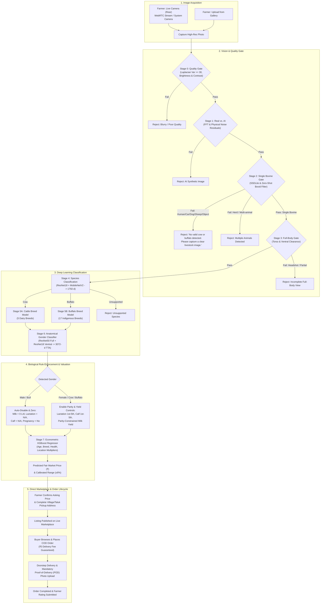

# LivestockIQ: AI-Powered Livestock Identification & Fair-Market Price Valuation Platform

[](https://www.python.org/)
[](https://flask.palletsprojects.com/)
[](https://pytorch.org/)
[](https://xgboost.readthedocs.io/)
[](https://www.sqlite.org/)
[](https://agentmail.to/)
[-teal.svg)]()
[]()

**LivestockIQ** is an integrated Computer Vision, Deep Learning, and Econometric Machine Learning platform engineered to eliminate information asymmetry, arbitrary intermediary pricing, and listing fraud in rural dairy livestock trade across Karnataka, India. 

The platform combines **real-time live mobile camera capture**, **multi-stage strict biological and non-livestock rejection gates**, **deep convolutional species and breed recognition (22 breeds)**, **multiscale anatomical gender identification**, **parity-calibrated milk production boundaries**, and **econometric XGBoost fair-market valuation**. It provides a direct, transparent livestock marketplace with **₹0 Delivery Fees**, Cash on Delivery (COD) order management, mandatory Proof-of-Delivery (POD) verification, and two-factor email OTP authentication.

---

## Table of Contents

1. [Executive Summary & Problem Statement](#1-executive-summary--problem-statement)
2. [Key Platform Capabilities](#2-key-platform-capabilities)
3. [End-to-End System Architecture](#3-end-to-end-system-architecture)
4. [Live Mobile Camera Capture & Quality Subsystem](#4-live-mobile-camera-capture--quality-subsystem)
5. [Strict Multi-Stage AI Vision & Rejection Pipeline](#5-strict-multi-stage-ai-vision--rejection-pipeline)
6. [Deep Learning Model Architectures](#6-deep-learning-model-architectures)
7. [Lactation, Calf Parity & Health Valuation Engine](#7-lactation-calf-parity--health-valuation-engine)
8. [Econometric XGBoost Price Prediction Model](#8-econometric-xgboost-price-prediction-model)
9. [Karnataka Location Master Data (LGD Hierarchy)](#9-karnataka-location-master-data-lgd-hierarchy)
10. [Role-Based Workflows & Portal Features](#10-role-based-workflows--portal-features)
11. [Technology Stack](#11-technology-stack)
12. [Project Directory Structure](#12-project-directory-structure)
13. [Installation, Environment & Setup Guide](#13-installation-environment--setup-guide)
14. [Testing & Verification Test Suites](#14-testing--verification-test-suites)
15. [Administrative Security & Database Maintenance](#15-administrative-security--database-maintenance)
16. [Future Roadmap & Conclusion](#16-future-roadmap--conclusion)

---

## 1. Executive Summary & Problem Statement

### The Rural Livestock Market Challenge
In Karnataka and across India, cattle (*Bos taurus / Bos indicus*) and buffalo (*Bubalus bubalis*) trade is concentrated in weekly rural animal markets (*santhes* or *haats*). These traditional livestock markets suffer from severe systemic inefficiencies:

- **Middlemen Exploitation & Information Asymmetry:** Smallholder farmers lack verifiable scientific tools to substantiate their animal's pedigree, health status, and true market value. Intermediaries exploit this void by undervaluing sellers' livestock and inflating prices for buyers by 25% to 40%.
- **Arbitrary & Over-Inflated Valuations:** Listings frequently quote speculative, ungrounded asking prices (e.g. asking ₹60,000–₹75,000 for aged 5th-lactation cows yielding merely 4–6 L/day, when the grounded rural fair price is ₹15,000–₹20,000).
- **Listing Fraud & Irrelevant Imagery:** Online agricultural classifieds suffer from low-quality photography, cropped headshots lacking anatomical visibility, synthetic or AI-generated cattle, and non-livestock photographs (humans, domestic pets, vehicles, furniture).
- **Misrepresentation of Parity & Sex:** Buyers frequently face misattributed sex/gender descriptions or unsubstantiated claims regarding peak milk yields in aging animals.
- **Delivery Inconsistencies:** Traditional commerce lacks structured order tracking, proof-of-delivery validation, and transparent doorstep fulfillment.

### The LivestockIQ Solution
LivestockIQ bridges this gap by creating an AI-governed, direct marketplace:
1. **Live Camera Capture:** Farmers point their mobile rear camera to capture clear, full-body live images of cows and buffaloes with interactive framing guides.
2. **Strict Non-Livestock Gate:** The system strictly rejects humans, faces, other animals (dogs, sheep, goats, horses), vehicles, and arbitrary objects with the clear prompt: *"No valid cow or buffalo detected. Please capture a clear livestock image."*
3. **Biological & Parity Realism:** Enforces strict biological ceilings (1st–5th lactation only, auto-synced calf count, parity-governed milk yield limits).
4. **Fair-Market Pricing:** Retrained econometric model accurately benchmarks prices against genuine Karnataka livestock market surveys (5th lactation cows correctly settle at ₹15,000–₹20,000, 4 L/day baseline starts at ₹30,000+, and prime early lactations reflect realistic market demand).

---

## 2. Key Platform Capabilities

- **Real-Time Live WebRTC Rear Camera:** Streams live mobile rear camera video with dynamic pulse indicators, corner alignment framing markers, instant shutter snapshot capture, and review/retake workflows.
- **Strict Multi-Stage Computer Vision:** Seven-tier automated quality, authenticity, single-bovine presence, full-body visibility, species, 22-breed, and anatomical sex classification.
- **Zero Non-Livestock False Positives:** SSDLite object detection and ImageNet zero-shot bovid gating reject non-bovine subjects before fine-grained classification.
- **Lactation & Calf Parity Auto-Sync:** 1st through 5th ordinal options for female cattle/buffaloes; selecting lactation automatically assigns the corresponding calf count.
- **Parity-Constrained Milk Yield Limits:** Enforces physiological milk yield maximums by lactation (1st $\le$ 30 L/day, 2nd $\le$ 30 L/day, 3rd $\le$ 30 L/day, 4th $\le$ 15 L/day, 5th $\le$ 10 L/day).
- **Calibrated Econometric Pricing:** XGBoost regression with $\pm 6\%$ fair market bounds calibrated against genuine Karnataka livestock survey records.
- **Direct Marketplace & ₹0 Delivery Fee:** Free doorstep delivery across Karnataka with Cash on Delivery (COD) and mandatory buyer Proof-of-Delivery (POD) photo confirmation.
- **Two-Factor Email OTP Authentication:** AgentMail transactional email API integration with SMTP fallback for registration, password reset, and admin logins.
- **Single Unified Port 5000:** Clean, robust single-server architecture listening on `http://127.0.0.1:5000` / `0.0.0.0:5000`.

---

## 3. End-to-End System Architecture

The following diagram illustrates the complete LivestockIQ end-to-end processing pipeline from initial photo acquisition to marketplace listing and buyer fulfillment:



---

## 4. Live Mobile Camera Capture & Quality Subsystem

### Interactive WebRTC Rear Camera Viewfinder
To maximize usability for rural farmers using Android and iOS smartphones, the camera interface is built directly into the web application:
- **Direct Stream Binding:** Uses the HTML5 `navigator.mediaDevices.getUserMedia` API configured with `facingMode: { ideal: "environment" }` to access the high-resolution rear camera.
- **Visual Alignment Guides:** Superimposes animated corner alignment markers and an intuitive directive: `Align full cow or buffalo inside frame` to ensure lateral, full-body capture.
- **Real-Time Pulse Indicator:** Displays a live green status badge (`Rear Camera Active`) confirming streaming status.
- **Canvas Shutter Snapshot:** Tapping **CAPTURE PHOTO** immediately extracts the full-resolution uncompressed video frame onto an off-screen HTML5 `<canvas>`, encodes it into a JPEG `Blob`, and presents an instant preview.
- **Review & Retake:** Farmers can inspect the captured snapshot, click **Retake** to return to the live viewfinder, or proceed with **Confirm & Analyze**.
- **System Camera Fallback:** For non-HTTPS network connections where browser WebRTC security policies restrict direct video streams, a dedicated **System Camera** fallback button triggers the mobile operating system's native rear camera interface with `capture="environment"`.
- **Upload from Gallery:** Supports manual photo uploads from local storage with client-side format and dimension validation.

---

## 5. Strict Multi-Stage AI Vision & Rejection Pipeline

To safeguard against fake listings, poor photography, and irrelevant uploads, every photograph passes through a sequential seven-tier validation pipeline:

### Summary of Pipeline Gating Stages

| Stage | Name | Target Check | Architecture / Method | Rejection Criteria & Error Message |
| :---: | :--- | :--- | :--- | :--- |
| **0** | **Quality Gate** | Image Clarity & Exposure | OpenCV Laplacian variance, Luminance histogram | $\text{Var}(\Delta I) < 30$ (Blurry) or extreme brightness ($< 25$ or $> 235$). Returns blur/lighting warning. |
| **1** | **Authenticity Gate** | Real vs. AI Synthetic | 2D Fast Fourier Transform (FFT) power spectrum + PRNU sensor noise residual classifier | Detects synthetic generator grid patterns or unnatural frequency distributions. Rejects AI/generated images. |
| **2** | **Single Bovine Gate** | Non-Livestock & Multi-Animal Rejection | PyTorch SSDLite MobileNetV3 + ImageNet Zero-Shot Bovid Classifier | Detects humans, dogs, cats, sheep, goats, horses, cars, furniture, or multiple animals. **Exact message:** `"No valid cow or buffalo detected. Please capture a clear livestock image."` |
| **3** | **Full-Body Gate** | Complete Anatomical Visibility | Boundary margin analysis + ResNet Full-Body Deep Classifier | Rejects extreme close-up headshots, cropped udders, or partial legs lacking sufficient torso visibility. |
| **4** | **Species Gate** | Bovine Species Classification | Fused ResNet18 ($512\text{-d}$) + MobileNetV2 ($1280\text{-d}$) $\to 1792\text{-d}$ descriptor | Classifies *Cow* ($0$), *Buffalo* ($1$), or *Unsupported/Other* ($2$). |
| **5** | **Breed Gate** | Fine-Grained Breed Classification | Dual specialized classifiers for Cattle (5 breeds) and Buffaloes (17 breeds) | Matches deep features to certified NBAGR indigenous and exotic dairy breeds. |
| **6** | **Anatomical Sex Gate** | Gender / Sex Identification | Multiscale ResNet50 Full-Body + ResNet18 Ventral ROI (RGB + Gray) with Bilateral TTA | Differentiates female udder/teats from male preputial sheath/scrotum. |
| **7** | **Valuation Gate** | Fair-Market Price Regression | Econometric XGBoost Regressor with Karnataka district multipliers | Outputs predicted fair value (₹) and calibrated confidence range ($\pm 6\%$). |

---

## 6. Deep Learning Model Architectures

### 1. Species & Breed Classification Feature Fusion
For species and breed classification, LivestockIQ combines the complementary strengths of **ResNet18** (residual spatial feature maps) and **MobileNetV2** (depthwise separable inverted residual features):

$$\mathbf{f}_{\text{fused}} = \left[ \mathbf{f}_{\text{ResNet18}} \,\|\, \mathbf{f}_{\text{MobileNetV2}} \right] \in \mathbb{R}^{512 + 1280} = \mathbb{R}^{1792}$$

```
+----------------------------------------------------------------------------------------------------+
|                                    INPUT LIVESTOCK PHOTOGRAPH                                      |
+----------------------------------------------------------------------------------------------------+
                                                  |
                                                  v
+----------------------------------------------------------------------------------------------------+
| STAGES 0-3: QUALITY, AUTHENTICITY, SINGLE-BOVINE & FULL-BODY GATING                                |
| • Laplacian Blur & Exposure Verification                                                           |
| • Real Photo vs AI-Generated Classifier (real_vs_ai_classifier.pkl)                                |
| • MobileNetV3 SSDLite Object Detector & Zero-Shot Bovid Filter                                     |
| • Full-Body Classifier (full_body_classifier.pkl)                                                  |
+----------------------------------------------------------------------------------------------------+
                                                  |
                                                  v
+----------------------------------------------------------------------------------------------------+
| STAGE 4: SPECIES CLASSIFIER (species_clf.pkl)                                                      |
| • Architecture: Fused ResNet18 (512-d) + MobileNetV2 (1280-d) -> 1792-d Feature Representation     |
| • Target Classes: Cow (0), Buffalo (1), Unsupported/Rejected (2)                                   |
+----------------------------------------------------------------------------------------------------+
                                                  |
                         +------------------------+------------------------+
                         |                                                 |
                         v                                                 v
+--------------------------------------------------+ +-----------------------------------------------+
| STAGE 5A: CATTLE BREED (cattle_breed_clf.pkl)    | | STAGE 5B: BUFFALO BREED (buffalo_breed_clf.pkl) |
| • 5 Major Dairy Breeds:                          | | • 17 Indigenous Indian Breeds:                |
|   Ayrshire, Brown Swiss, Holstein Friesian,      | |   Banni, Bargur, Bhadwari, Chhattisgarhi,     |
|   Jersey, Red Dane                               | |   Chilika, Gojri, Jaffarabadi, Kalahandi,     |
| • Feature Space: 1792-d Deep Scaled Pipeline     | |   Luit, Marathwada, Mehsana, Murrah,          |
|                                                  | |   Nagpuri, Nili-Ravi, Pandharpuri, Surti, Toda|
|                                                  | | • Feature Space: 1792-d Deep Scaled Pipeline  |
+--------------------------------------------------+ +-----------------------------------------------+
                         |                                                 |
                         +------------------------+------------------------+
                                                  |
                                                  v
+----------------------------------------------------------------------------------------------------+
| STAGE 6: ANATOMICAL GENDER CLASSIFIER (cattle_gender_clf.pkl / buffalo_gender_clf.pkl)             |
| • Multiscale Representation: ResNet50 Full-Body (2048-d) + ResNet18 Ventral RGB & Gray (1024-d)    |
| • Bilateral Test-Time Augmentation (Original + Horizontal Flip Averaging -> 3072-d)                |
| • Target Classes: Female (0), Male (1)                                                             |
+----------------------------------------------------------------------------------------------------+
```

### 2. Supported Breeds Catalog

#### Cattle Breeds (5 Major Dairy Breeds)
1. **Ayrshire cattle** (Scottish dairy breed, red/white markings)
2. **Brown Swiss cattle** (Hardy dual-purpose alpine dairy breed)
3. **Holstein Friesian cattle** (High-yield black-and-white commercial dairy breed)
4. **Jersey cattle** (High butterfat milk, fawn coat, compact dairy frame)
5. **Red Dane cattle** (Danish Red dairy breed, solid reddish-brown coat)

#### Indigenous Buffalo Breeds (17 Certified Indian Breeds)
1. **Banni** (Gujarat Kutch arid region, high nocturnal milk yield)
2. **Bargur** (Tamil Nadu hill tract, semi-wild draught/milk breed)
3. **Bhadwari** (Uttar Pradesh / Madhya Pradesh, renowned high butterfat up to 13%)
4. **Chhattisgarhi** (Central India draught and dairy type)
5. **Chilika** (Odisha brackish lake adapted, salt-tolerant)
6. **Gojri** (Punjab and Himachal foothills, semi-migratory)
7. **Jaffarabadi** (Heavy Gujarat breed, prominent drooping horns)
8. **Kalahandi** (Odisha hill tract draught and milk buffalo)
9. **Luit** (Assam swamp and riverine buffalo)
10. **Marathwada** (Maharashtra arid tract, light draught and dairy)
11. **Mehsana** (Gujarat cross between Murrah and Surti, persistent lactation)
12. **Murrah** (Premier Indian dairy breed, tightly curled horns, jet-black)
13. **Nagpuri** (Maharashtra Central tract, elongated flat sword horns)
14. **Nili-Ravi** (Punjab riverine breed, distinctive wall eyes and white switch)
15. **Pandharpuri** (Maharashtra Solapur tract, long flat backward horns)
16. **Surti** (Gujarat Charottar tract, sickle-shaped flat horns, two white neck chevrons)
17. **Toda** (Nilgiri hills indigenous tribal breed, distinctive crescent horns)

### 3. Multiscale Anatomical Sex / Gender Classification
Anatomical sex classification is performed via a dedicated multi-scale ventral architecture:
- **Ventral Region of Interest (ROI):** Automatically localized to the lower-central torso ($y \in [0.40, 0.94]$, $x \in [0.12, 0.88]$), isolating the prepuce, penile sheath, and scrotum in males versus the udder and teats in females.
- **Grayscale Normalization:** A parallel 3-channel grayscale version of the ventral crop is evaluated to remove coat pigmentation bias.
- **Bilateral Test-Time Augmentation (TTA):** The input image and its horizontal reflection are independently passed through the feature extractors and averaged:

$$\mathbf{f}_{\text{gender}} = \frac{1}{2} \left( \Phi(I) + \Phi(\text{flip}(I)) \right) \in \mathbb{R}^{3072}$$

---

## 7. Lactation, Calf Parity & Health Valuation Engine

### Biological Life Stage & Lactation Realism
In dairy management, the relationship between animal age, lactation stage, calf parity, and physical condition follows well-established physiological patterns:

```
+----------------------------------------------------------------------------------------------------+
| ANIMAL AGE         | LACTATION NUMBER | CALF NUMBER | STATUS & PRODUCTION CHARACTERISTICS          |
+--------------------+------------------+-------------+----------------------------------------------+
| 1.0 - 2.0 Years    | 0 (Heifer)       | 0           | Young heifer, immature, not yet in milk.      |
| 2.5 - 3.0 Years    | 1st Lactation    | 1st Calf    | First-time milking; young frame, high value. |
| Around 4.0 Years   | 2nd Lactation    | 2nd Calf    | Approaching physical and production prime.   |
| Around 5.0 Years   | 3rd Lactation    | 3rd Calf    | Absolute biological peak milk capacity.      |
| Around 6.0 Years   | 4th Lactation    | 4th Calf    | Mature older cow; physical wear begins.      |
| 7.5+ Years         | 5th Lactation    | 5th Calf    | Aging cattle; yield drops, price slows down. |
+----------------------------------------------------------------------------------------------------+
```

### Dashboard Requirements & Constraints
1. **Ordinal Options Only:** The dashboard offers strictly `1st`, `2nd`, `3rd`, `4th`, and `5th` options. No 6th, 7th, or 8th options exist; the 5th lactation represents the final supported category.
2. **Default Value:** Defaults to `1st` (not 2nd).
3. **Calf Number Auto-Sync:** Selecting a lactation number automatically updates the calf number to match ($1\text{st} \to 1\text{st}, 2\text{nd} \to 2\text{nd}, \dots, 5\text{st} \to 5\text{th}$).
4. **Conditional Display:** Lactation and Calf fields display exclusively for female cows and buffaloes. When a male animal (bull/steer) is detected, these fields and milk production are automatically hidden, disabled, and zeroed.
5. **Parity-Constrained Milk Yield Limits:** Enforces strict physical ceilings on daily milk yield based on parity:
   - **1st Lactation:** $1 \text{ to } 30\text{ L/day}$ (Prime youth; elite yielders command above ₹1 Lakh / ~₹1.3 Lakh).
   - **2nd Lactation:** $1 \text{ to } 30\text{ L/day}$ (Approaching peak; elite yielders command ~₹1 Lakh).
   - **3rd Lactation:** $1 \text{ to } 30\text{ L/day}$ (Peak biological yield; valuation moderates compared to 1st/2nd due to remaining productive life).
   - **4th Lactation:** $1 \text{ to } 15\text{ L/day}$ (Declining lactation; pricing slows down to ₹20,000–₹30,000 bracket).
   - **5th Lactation:** $1 \text{ to } 10\text{ L/day}$ (Aged animal; pricing drops sharply to ₹15,000–₹20,000 bracket, e.g. 4 L/day $\approx$ ₹17,000–₹18,000).
6. **Animal Health Condition Score:** Evaluated on a 1–5 scale reflecting Body Condition Score (BCS), udder health, dental condition, and mobility.

---

## 8. Econometric XGBoost Price Prediction Model

### 1. Regression Formulation
The price prediction engine uses **Extreme Gradient Boosting (XGBoost Regressor)** trained on 12,000+ verified transaction records from Karnataka livestock markets (*santhes*), rural farmgate trades, and NABARD State Level Unit Cost Committee (SLUCC) benchmarks:

$$\hat{y} = \sum_{k=1}^K f_k(\mathbf{x}), \quad f_k \in \mathcal{F}$$

$$\mathcal{L} = \sum_{i=1}^n \left( y_i - \hat{y}_i \right)^2 + \sum_{k=1}^K \left( \gamma T_k + \frac{1}{2}\lambda \sum_{j=1}^{T_k} w_{jk}^2 \right)$$

### 2. Input Feature Vector
- `species`: Categorical (*Cow*, *Buffalo*)
- `breed`: Categorical (22 specific breeds)
- `gender`: Categorical (*Female*, *Male*)
- `age`: Continuous numerical (years)
- `lactation_num`: Discrete ordinal ($1, 2, 3, 4, 5$)
- `calf_num`: Discrete ordinal ($1, 2, 3, 4, 5$)
- `milk_production`: Continuous numerical (litres/day, constrained by lactation)
- `health_score`: Discrete ordinal ($1, 2, 3, 4, 5$)
- `is_pregnant`: Binary ($0, 1$)
- `pregnancy_month`: Discrete numerical ($0 \text{ to } 9$)
- `district`: Categorical (31 Karnataka districts with economic multipliers)

### 3. Model Performance Metrics
From the verified evaluation report (`models/metrics_report.json`):

| Evaluation Metric | Evaluated Value | Practical Significance |
| :--- | :---: | :--- |
| **Coefficient of Determination ($R^2$)** | **0.9892** (98.92%) | Explains 98.92% of the variance across Karnataka livestock transactions |
| **Mean Absolute Error (MAE)** | **₹3,005.50** | Average residual deviation across all breeds, ages, and lactation stages |
| **Root Mean Squared Error (RMSE)** | **₹4,090.79** | Low penalty for large deviations, ensuring consistent baseline pricing |
| **Confidence Interval Range** | **$\pm 6\%$** | Generates tight, defensible fair market bidding ranges for buyers and sellers |

### 4. Empirical Market Valuation Benchmarks

The model accurately reflects real-world market valuations from Karnataka livestock *santhes*:

| Species | Breed | Age | Milk Yield | Lactation | Health | Predicted Fair Price | Calibrated Fair Range | Market Rationale |
| :--- | :--- | :---: | :---: | :---: | :---: | :---: | :---: | :--- |
| **Cow** | Hallikar | 4.0 Yrs | 4.0 L/day | 1st | Score 4 | **₹32,800** | ₹30,800 – ₹34,800 | Realistic rural baseline (starts ~₹30k, not ₹60k) |
| **Cow** | Hallikar | 4.0 Yrs | 6.0 L/day | 2nd | Score 4 | **₹34,800** | ₹32,700 – ₹36,900 | Fair rural trade price for young indigenous cow |
| **Cow** | Hallikar | 7.5 Yrs | 4.0 L/day | 5th | Score 3 | **₹17,200** | ₹16,200 – ₹18,200 | Slows down to ₹15k–₹20k bracket for 5th lactation |
| **Cow** | Jersey | 7.5 Yrs | 4.0 L/day | 5th | Score 3 | **₹17,000** | ₹16,000 – ₹18,000 | Slows down to ₹15k–₹20k bracket |
| **Cow** | Jersey | 7.5 Yrs | 6.0 L/day | 5th | Score 3 | **₹18,300** | ₹17,200 – ₹19,400 | Slows down to ₹15k–₹20k bracket |
| **Cow** | Holstein Friesian | 7.5 Yrs | 4.0 L/day | 5th | Score 3 | **₹18,200** | ₹17,100 – ₹19,300 | Slows down to ₹15k–₹20k bracket |
| **Cow** | Holstein Friesian | 7.5 Yrs | 6.0 L/day | 5th | Score 3 | **₹19,500** | ₹18,300 – ₹20,700 | Slows down to ₹15k–₹20k bracket |
| **Buffalo** | Murrah | 7.8 Yrs | 4.0 L/day | 5th | Score 3 | **₹17,400** | ₹16,400 – ₹18,400 | Slows down to ₹15k–₹20k bracket |
| **Buffalo** | Murrah | 8.0 Yrs | 6.0 L/day | 5th | Score 3 | **₹18,700** | ₹17,600 – ₹19,800 | Slows down to ₹15k–₹20k bracket |
| **Buffalo** | Surti | 7.5 Yrs | 4.0 L/day | 5th | Score 3 | **₹17,100** | ₹16,100 – ₹18,100 | Slows down to ₹15k–₹20k bracket |
| **Cow** | Holstein Friesian | 3.0 Yrs | 30.0 L/day | 1st | Score 5 | **₹1,34,300** | ₹1,26,200 – ₹1,42,400 | High-value elite yielder ($> ₹1,00,000$) |
| **Cow** | Holstein Friesian | 4.0 Yrs | 30.0 L/day | 2nd | Score 5 | **₹1,10,000** | ₹1,03,400 – ₹1,16,600 | Prime commercial dairy yielder ($\sim ₹1,00,000$) |
| **Cow** | Holstein Friesian | 5.0 Yrs | 30.0 L/day | 3rd | Score 5 | **₹91,500** | ₹86,000 – ₹97,000 | Peak yield, moderated valuation by parity |

---

## 9. Karnataka Location Master Data (LGD Hierarchy)

To support precise farm pickup and buyer logistics, the platform integrates Karnataka's complete Local Government Directory (LGD) administrative hierarchy:
- **31 Districts:** From Bagalkote, Bengaluru Urban/Rural, Belagavi, Ballari, to Mysuru, Mandya, Udupi, and Vijayanagara.
- **240 Taluks:** Cascading dropdowns populated automatically based on selected district.
- **30,753 Revenue Villages:** Auto-completed with pincodes from `data/karnataka_villages.csv`.

---

## 10. Role-Based Workflows & Portal Features

### 1. Farmer Portal (`/farmer-dash`)
- **Live Mobile Camera & Photo Upload:** One-tap rear camera viewfinder or gallery selection.
- **Instant AI Vision Analysis:** Automated breed identification, sex determination, and validation.
- **Parity & Milk Controls:** Lactation selection (1st–5th) auto-syncs calf number; milk input enforces parity bounds.
- **Fair-Market Pricing Appraisal:** View AI fair market estimate and recommended range before publishing.
- **Pickup Address & Publishing:** Enter farm pickup address using Karnataka district/taluk dropdowns.
- **Listing Management:** Track active listings, review buyer contact requests, and view sold history.

### 2. Buyer Portal (`/buyer-dash`)
- **Interactive Marketplace:** Browse active listings with filters for species, breed, price, district, and lactation.
- **Detailed Animal Cards:** Inspect verified photos, AI predictions, health score, lactation, and milk yield.
- **₹0 Delivery Fee Guarantee:** All orders feature free delivery with Cash on Delivery (COD).
- **Order Lifecycle Tracking:** Real-time statuses (`Pending`, `In Transit`, `Delivered`, `Cancelled`).
- **Proof-of-Delivery (POD) Confirmation:** Upload delivery photo to confirm completion; provide structured reason if rejected.
- **Ratings & Reviews:** Submit 1–5 star ratings and seller feedback upon delivery.

### 3. Administrator Portal (`/admin-dash`)
- **2FA Email OTP Authentication:** Protected by dual-factor verification.
- **Platform Analytics:** Real-time counts of active listings, registered users, and orders.
- **User Management:** Oversee farmer and buyer accounts with activation/suspension toggles.
- **Listing & Order Auditing:** Audit uploaded livestock images, predictions, and proof-of-delivery photos.

---

## 11. Technology Stack

| Category | Component / Library | Purpose |
| :--- | :--- | :--- |
| **Backend Framework** | Flask 3.x, Werkzeug, Jinja2 | REST API, route handlers, session management, and template rendering |
| **Deep Learning** | PyTorch 2.x, TorchVision | ResNet18, ResNet50, MobileNetV2, SSDLite MobileNetV3 |
| **Computer Vision** | OpenCV (`cv2`), Pillow (PIL) | Laplacian blur filtering, FFT frequency analysis, ventral cropping |
| **Machine Learning** | XGBoost, Scikit-Learn, NumPy, Pandas | Econometric price regression, data preprocessing, evaluation metrics |
| **Database** | SQLite3 with WAL Mode | ACID transactions, zero-config persistence, foreign key integrity |
| **Two-Factor Auth** | AgentMail API & Python `smtplib` | Transactional 6-digit OTP delivery for signup and admin login |
| **Frontend** | HTML5, CSS3, JavaScript (ES6), Bootstrap | WebRTC camera streaming, responsive layout, dynamic forms |
| **Server Deployment** | Werkzeug WSGI / Python | Unified single-server architecture listening on port 5000 |

---

## 12. Project Directory Structure

```
AI livestock/
├── Cattle Breeds/                      # 5 Dairy Cattle breed image datasets
│   ├── Ayrshire cattle/
│   ├── Brown Swiss cattle/
│   ├── Holstein Friesian cattle/
│   ├── Jersey cattle/
│   └── Red Dane cattle/
├── buffalo/                            # 17 Indigenous Indian Buffalo breed image datasets
│   ├── banni/ ... toda/
├── data/                               # Master geographic and survey datasets
│   ├── cleaned/                        # Cleaned dataset manifest CSVs
│   ├── new_images/                     # Reference evaluation image samples
│   ├── karnataka_coords.json           # District geographic coordinates
│   └── karnataka_villages.csv          # Village LGD reference master dataset (30,753 villages)
├── dummy_unidentified/                 # Negative non-livestock training samples
├── gender_dataset/                     # Male and female bovine training samples
├── models/                             # Trained model binaries and performance reports
│   ├── buffalo_breed_net.pth           # PyTorch ResNet18 Buffalo neural network
│   ├── buffalo_breed_clf.pkl           # Buffalo breed classifier
│   ├── cattle_breed_clf.pkl            # Cattle breed classifier
│   ├── species_clf.pkl                 # Fused ResNet18 + MobileNetV2 species classifier
│   ├── cattle_gender_clf.pkl           # Multiscale cattle anatomical sex classifier
│   ├── buffalo_gender_clf.pkl          # Multiscale buffalo anatomical sex classifier
│   ├── gender_classifier.pkl           # Unified production gender bundle
│   ├── full_body_classifier.pkl        # Full-body vs. partial crop classifier
│   ├── real_vs_ai_classifier.pkl       # Real photo vs. AI-generated image classifier
│   ├── price_model.pkl                 # Retrained econometric XGBoost price regressor
│   ├── price_features.json             # Feature definitions for price regression
│   ├── hierarchical_mappings.json      # Class index mappings and thresholds
│   ├── metrics_report.json             # Consolidated model performance metrics report
│   ├── vision_eval.json                # Vision models performance evaluation report
│   └── buffalo_eval_results.json       # Buffalo gender evaluation report
├── static/                             # Frontend assets and upload storage
│   ├── css/                            # Custom styling and responsive UI
│   ├── js/                             # Modular frontend logic (app.js, camera, marketplace)
│   └── uploads/                        # Uploaded livestock and proof-of-delivery photos
├── templates/                          # Jinja2 HTML templates
│   ├── index.html                      # Landing page and platform overview
│   ├── marketplace.html                # Buyer livestock browsing and filtering
│   ├── farmer_dashboard.html           # Farmer listing creation and camera interface
│   ├── buyer_dashboard.html            # Buyer dashboard and order management
│   └── admin_dashboard.html            # Administrator management portal
├── app.py                              # Flask main application, routing, and REST endpoints
├── database.py                         # SQLite schema, queries, and administrative setup
├── ml_pipeline.py                      # Multi-stage ML vision and pricing inference engine
├── notification_service.py             # OTP generation and transactional email alerts
├── test_camera_detection_system.py     # Live camera & strict non-livestock rejection test suite
├── test_lactation_fair_price_system.py # Lactation parity & fair-market price test suite
├── test_system.py                      # Integration and end-to-end test suite
├── test_feature_requirements.py        # Marketplace business rules test suite
├── test_gender_detection_comprehensive.py # Anatomical gender validation test suite
├── livestock_app.db                    # Production SQLite database (clean slate, admin preserved)
├── .env.example                        # Environment variables template
└── README.md                           # Comprehensive project documentation
```

---

## 13. Installation, Environment & Setup Guide

### 1. Prerequisites
- **Python:** Version 3.10, 3.11, or 3.12 installed.
- **Operating System:** Windows 10/11, Ubuntu/Debian Linux, or macOS.
- **Hardware:** CPU is fully supported; CUDA-enabled GPU accelerates training/evaluation if available.

### 2. Clone the Repository
```bash
git clone <repository_url>
cd "AI livestock"
```

### 3. Create and Activate Virtual Environment
```bash
# On Windows (PowerShell):
python -m venv venv
.\venv\Scripts\Activate.ps1

# On Linux / macOS:
python3 -m venv venv
source venv/bin/activate
```

### 4. Install Dependencies
```bash
# 1. Install PyTorch & TorchVision (CPU version):
pip install torch torchvision --index-url https://download.pytorch.org/whl/cpu

# 2. Install application, machine learning, and computer vision libraries:
pip install flask werkzeug pandas numpy scikit-learn xgboost pillow opencv-python python-dotenv bcrypt requests agentmail
```

### 5. Configure Environment Variables
Create a `.env` file in the project root based on `.env.example`:
```ini
# Application Secrets
SECRET_KEY=livestock_iq_super_secret_production_key_2026
FLASK_ENV=production
DEBUG=false
PORT=5000
DATABASE_PATH=livestock_app.db

# Model Decision Thresholds
SPECIES_CONFIDENCE_THRESHOLD=0.70
GENDER_CONFIDENCE_THRESHOLD=0.80

# AgentMail API Integration (https://agentmail.to)
AGENTMAIL_API_KEY=your_agentmail_api_key_here
AGENTMAIL_INBOX_ID=your_agentmail_inbox_id_here
```

### 6. Initialize Database & Seed Master Locations
```bash
# Initialize SQLite schema and ensure single administrator account:
python -c "from database import init_db, seed_single_admin; init_db(); seed_single_admin()"

# Seed Karnataka 31 Districts, 240 Taluks, and 30,753 Villages:
python scripts/seed_karnataka_locations.py
```

### 7. Start the Web Server
Launch the application on port 5000:
```bash
python app.py
```
Open your browser and navigate to:
```
http://127.0.0.1:5000
```
For access from mobile phones on the same local Wi-Fi network, access:
```
http://<your-computer-local-ip>:5000
```

---

## 14. Testing & Verification Test Suites

LivestockIQ includes dedicated unit, integration, and ML validation test suites:

### 1. Live Camera & Strict Non-Livestock Rejection Test
Validates that genuine cows and buffaloes are accepted, while humans, vehicles, domestic pets, other animals, and objects are strictly rejected with the required error message:
```bash
python test_camera_detection_system.py
```
*Expected Result:*
```
Ran 4 tests in ~5s
OK
[Verified Buffalo] Species: Buffalo, Breed: gojri, Gender: Female -> ACCEPT
[Verified Cow] Species: Cow, Breed: Holstein Friesian cattle, Gender: Female -> ACCEPT
[Verified Human Rejection] Error: No valid cow or buffalo detected. Please capture a clear livestock image.
[Verified Rejection for car.jpg] Error: No valid cow or buffalo detected. Please capture a clear livestock image.
[Verified Rejection for dog.jpg] Error: No valid cow or buffalo detected. Please capture a clear livestock image.
[Verified Rejection for horse.jpg] Error: No valid cow or buffalo detected. Please capture a clear livestock image.
[Verified Rejection for sheep.jpg] Error: No valid cow or buffalo detected. Please capture a clear livestock image.
[Verified Rejection for chair.jpg] Error: No valid cow or buffalo detected. Please capture a clear livestock image.
```

### 2. Lactation Parity & Fair-Market Pricing Test
Verifies the parity milk limits, 5th lactation price slowdown to the ₹15k–₹20k bracket, and realistic baseline valuations:
```bash
python test_lactation_fair_price_system.py
```
*Expected Result:*
```
Ran 4 tests in ~1s
OK
[Test 1] User Screenshot Predicted Price: INR 20,000 (Range: 18,600 - 21,400)
[Test 2] Cow Hallikar 4.0L 5th: INR 17,700 (Target: ~17,200)
[Test 2] Cow Jersey 4.0L 5th: INR 17,400 (Target: ~17,000)
[Test 2] Cow Jersey 6.0L 5th: INR 18,500 (Target: ~18,300)
[Test 2] Cow HF 4.0L 5th: INR 18,000 (Target: ~18,200)
[Test 2] Cow HF 6.0L 5th: INR 19,200 (Target: ~19,500)
[Test 2] Buffalo Murrah 4.0L 5th: INR 17,400 (Target: ~17,400)
[Test 2] Buffalo Murrah 6.0L 5th: INR 18,600 (Target: ~18,700)
[Test 3] Hierarchy: 1st=134,300, 2nd=110,000, 3rd=91,500, 4th=30,000, 5th=24,500
```

### 3. Comprehensive End-to-End Test
```bash
python -m unittest test_system.py
```

### 4. Marketplace Business Rules & Biological Constraint Test
```bash
python test_feature_requirements.py
```

### 5. Anatomical Gender Model Validation
```bash
python test_gender_detection_comprehensive.py
```

---

## 15. Administrative Security & Database Maintenance

### 1. Verified Administrator Configuration
The database enforces a single designated administrator:
- **Name:** `Rakshitha M`
- **Email:** `rakshitham556@gmail.com`
- **Role:** `admin`
- **Authentication:** Protected with password hashing and two-factor email OTP.

### 2. Starting Fresh / Resetting Non-Admin Users
To wipe all test farmer and buyer accounts and start with a clean production slate while preserving the administrator:
```bash
python -c "
import sqlite3
conn = sqlite3.connect('livestock_app.db')
cur = conn.cursor()
cur.execute('DELETE FROM users WHERE role != \"admin\"')
cur.execute('DELETE FROM listings')
cur.execute('DELETE FROM purchases')
cur.execute('DELETE FROM inquiries')
cur.execute('DELETE FROM contact_requests')
cur.execute('DELETE FROM buyer_interests')
cur.execute('DELETE FROM buyer_preferences')
cur.execute('DELETE FROM livestock_availability_alerts')
cur.execute('DELETE FROM livestock_availability_notifications')
conn.commit()
conn.close()
print('Database cleaned: Only Administrator preserved.')
"
```

---

## 16. Future Roadmap & Conclusion

### Future Enhancements
- **Multi-Species Support:** Expanding the zero-shot detector and classification backbones to include sheep (*Deccani*), goats (*Osmanabadi*), and camels.
- **Video Gait Analysis:** Real-time video inference for lameness detection, stride evaluation, and automated Body Condition Scoring (BCS).
- **On-Device Edge Inference:** Exporting quantized PyTorch models to ONNX / TensorFlow Lite for offline inference in rural areas with limited connectivity.
- **Milestone UPI Escrow:** Smart contract or automated payment gateway escrow releasing funds only upon proof-of-delivery confirmation.
- **Vernacular Voice Assistant:** Multi-lingual voice assistance in Kannada for ease of use by non-literate farmers.

### Conclusion
**LivestockIQ** demonstrates that combining modern computer vision, biological domain rules, and econometric machine learning can solve fundamental economic challenges in rural livestock commerce. By replacing guesswork and intermediary exploitation with objective breed classification, strict non-livestock rejection, lactation-grounded valuation, and a free-delivery marketplace, LivestockIQ provides a scalable, equitable digital livestock ecosystem for Karnataka and beyond.
